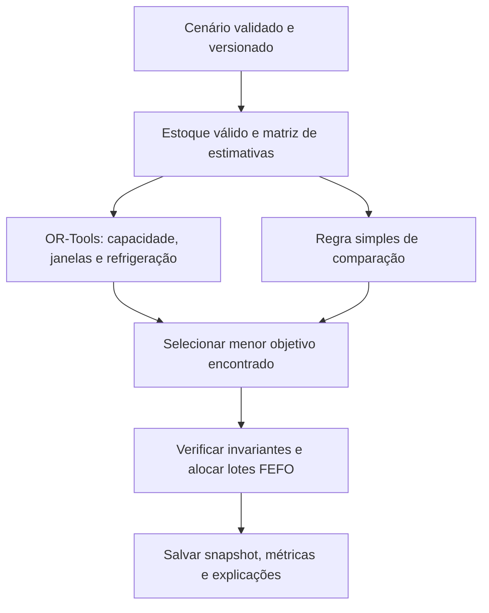

Logistics Intelligence

**Planejamento de distribuição com restrições, simulação de cenários e resultados auditáveis.**

Projeto de portfólio de **Erivan Santos Marques**. -Essa aplicação em **Python + FastAPI + OR-Tools** e uma interface **React + TypeScript** ao repositório acadêmico original.

## O que o sistema decide

Dado um conjunto de pedidos, lotes e veículos, o sistema propõe:

- Quais pedidos atender e em qual veículo.
- A sequência de paradas e os horários estimados de chegada e retorno.
- A distribuição de carga respeitando capacidade em peso e compatibilidade com refrigeração.
- Os lotes a separar, utilizando FEFO: primeiro a vencer, primeiro a sair.
- Os pedidos não alocados e as razões que podem ser verificadas.

O planejamento respeita **janelas de chegada, turno dos veículos, capacidade em kg, estoque válido por produto e necessidade de refrigeração**. Um pedido é atendido por inteiro ou não é atendido. Toda rota retorna ao centro de distribuição; cada veículo faz no máximo uma viagem por execução.

**É uma aplicação demonstrativa, não uma plataforma pronta para operar medicamentos ou dados reais de pacientes.** O modelo não inclui trânsito real, geocodificação, sensores, validação sanitária, múltiplos depósitos, devoluções ou reabastecimento em rota.

## Visite a demonstração

**[Abrir Logistics Intelligence online](https://erivan-logistics-intelligence.onrender.com/)** — não exige cadastro nem token para visitantes.

A demonstração pública apresenta um plano registrado do solver, com dados fictícios de 26/10/2026. Explore rotas, filtre pedidos, inspecione estoque/frota e baixe CSV ou JSON. Ela é somente leitura: não executa novos cálculos nem altera a operação. O botão **Acesso administrativo** permite ao responsável informar seu token para cadastrar, editar, recalcular e registrar expedições.

O resultado público vem de `docs/demo-result.json`, separado do banco de operação. Nenhuma consulta pública lê cenários particulares, histórico administrativo ou estoque atual. A chave administrativa não deve ser compartilhada com visitantes.

A hospedagem usa Render Free, que pode demorar cerca de um minuto para iniciar após ficar sem uso. O PostgreSQL gratuito atual expira em **25/11/2026**; é necessário migrá-lo antes dessa data para continuidade da operação.

Também é possível gerar uma prévia HTML somente leitura com `npm run preview:standalone`.

## Hospedar online

A aplicação completa pode ser hospedada no Render usando o [Blueprint e o roteiro de publicação](docs/DEPLOY_RENDER.md). A configuração solicita um serviço Docker e um banco PostgreSQL gratuitos. O banco gratuito expira em 30 dias; os limites e o controle de acesso estão documentados no roteiro. A URL funcional só existe depois que o provedor concluir o deploy.

## Executar localmente

Requisitos testados: **Python 3.12** e **Node.js 24**. A primeira instalação precisa de internet para baixar as dependências. Não usa APIs pagas nem exige chave de IA.

### Windows · PowerShell

Na pasta do projeto:

```powershell
python -m venv .venv-planner
.\.venv-planner\Scripts\python -m pip install -r requirements-planner.lock.txt
npm ci
npm run build:ui
npm start
```

### Linux / macOS

```bash
python3 -m venv .venv-planner
.venv-planner/bin/python -m pip install -r requirements-planner.lock.txt
npm ci
npm run build:ui
npm start
```

Abra **http://127.0.0.1:8000**. A API, a interface compilada e a documentação são servidas pelo mesmo processo.

- Interface: `/`
- Documentação interativa local: `/docs`
- Contrato OpenAPI: `/openapi.json`
- Saúde do processo: `/api/health`

O banco padrão é SQLite em `planner/data/planner.db`, criado automaticamente. A primeira inicialização de uma base vazia cria um cenário demonstrativo; executar uma simulação não altera o estoque.

### Desenvolvimento

Dois terminais:

```bash
# Backend
.venv-planner/bin/python -m uvicorn planner.api:app --reload --host 127.0.0.1 --port 8000
# Frontend
npm run dev:ui
```

No Windows, substitua o executável Python pelo caminho `\.venv-planner\Scripts\python`. O Vite usa proxy `/api` para o backend local. A documentação OpenAPI tem arquivos locais preparados por `npm run build:ui`, sem depender de CDN.

## Roteiro de demonstração

1. Clique em **Otimizar plano**. O cálculo usa até 3 segundos de busca e passa por um verificador independente de restrições antes de ser salvo.
2. Clique nos veículos e nos pontos da distribuição para inspecionar o plano.
3. Abra **Estoque & frota**. Confira o lote vencido excluído e as alocações FEFO.
4. Em **Editar dados**, altere quantidades, validade, capacidade ou refrigeração. É possível adicionar pedidos, lotes e veículos. Novos destinos exigem coordenadas explícitas.
5. Salve: o cenário recebe uma nova versão. Os planos antigos preservam os dados utilizados no cálculo.
6. Clique em **Simular cenário**. Teste demanda maior, menor velocidade média, mais capacidade ou um veículo refrigerado adicional.
7. Abra **Cenários & histórico** e selecione dois ou três planos para comparar atendimento, custos, distância, urgentes e ocupação.
8. Exporte o plano em CSV ou o conjunto completo de dados e resultados em JSON.
9. Em um plano da data de hoje, clique em **Confirmar expedição**, confira os dados e registre a baixa. Abra **Expedições** para conferir os saldos por lote e os pedidos retirados da fila.

## Confirmação de expedição

Calcular ou simular não altera o estoque. A confirmação explícita baixa os lotes FEFO, retira os pedidos atendidos da fila, incrementa a versão do cenário e registra a movimentação e a auditoria em uma única transação. O snapshot do plano permanece preservado.

Uma chave de idempotência permite repetir a mesma requisição após uma falha de rede sem repetir a baixa. Cada plano pode ser confirmado uma única vez; alterações no cenário ou outra expedição invalidam os demais planos da versão anterior. A API verifica novamente o plano e exige a data atual de São Paulo.

O registro vale apenas dentro desta aplicação demonstrativa. Não há integração com transportadoras, confirmação de entrega, reserva de estoque, cancelamento ou devolução de expedição.

## Resultado de referência — dados fictícios

Em `docs/demo-result.json`, uma execução registrada para **26/10/2026**, com 18 pedidos e 3 veículos, produziu:

| Indicador                   | Regra simples | Plano selecionado |
| --------------------------- | ------------: | ----------------: |
| Pedidos atendidos           |      16 de 18 |          16 de 18 |
| Urgentes atendidos          |        3 de 3 |            3 de 3 |
| Distância estimada          |    169,465 km |        108,495 km |
| Custo de transporte         |     R$ 650,84 |         R$ 458,91 |
| Ocupação da frota utilizada |         95,0% |             95,0% |

Nesse exemplo, o custo estimado foi **29,5% menor com o mesmo atendimento**. Isso não é uma promessa de economia real. Outro cenário ou limite de busca pode produzir valores diferentes. A busca local é limitada por tempo; não há prova de ótimo global.

A regra de referência ordena pedidos por prioridade, prazo e ID, e inclui cada pedido no final da rota viável com menor custo incremental. Usa as mesmas restrições do otimizador. O resultado selecionado nunca é pior que essa referência no **objetivo ponderado**; isso não garante menor custo isolado ou maior atendimento em todos os cenários.

## Como funciona a otimização



O objetivo combina **custos de ativação dos veículos + custos por distância + penalidades dos pedidos não atendidos**. Prioridades têm pesos configurados no código: normal R$ 800, alta R$ 2.000 e urgente R$ 5.000. As penalidades são um instrumento de priorização, não valores cobrados ou prejuízos financeiros reais.

Pedidos urgentes têm penalidade maior, mas o atendimento de todos eles não é uma garantia absoluta. Se as restrições forem incompatíveis, o pedido pode ficar fora do plano.

Veja [decisões e limites do algoritmo](docs/ALGORITMO.md) e [arquitetura](docs/ARQUITETURA.md).

### Indicadores e unidades

| Campo          | Definição                                                                                                      |
| -------------- | -------------------------------------------------------------------------------------------------------------- |
| Custo          | Soma de custo fixo e custo das distâncias percorridas pelos veículos utilizados, inclusive retorno ao depósito |
| Distância      | Haversine entre coordenadas multiplicada pelo fator viário; não segue uma malha de ruas                        |
| Tempo          | Distância estimada / velocidade média, com espera e tempo de serviço; origem 08:00 em São Paulo                |
| Janela         | Limite para **chegada**; o serviço pode terminar depois do fim da janela                                       |
| Ocupação       | Peso total alocado / capacidade dos veículos utilizados                                                        |
| Estoque válido | Lotes cujo vencimento seja igual ou posterior à data do planejamento                                           |
| FEFO           | Ordenação por validade e ID de lote, aplicada aos pedidos selecionados                                         |

As rotas desenhadas na interface são esquemáticas. Refrigeração indica compatibilidade declarada do veículo, sem medição de temperatura. A seleção e a alocação são propostas de simulação: **não reservam nem baixam estoque**.

## Persistência e PostgreSQL

SQLAlchemy armazena cenários versionados, execuções com snapshots imutáveis e eventos de auditoria. SQLite funciona sem serviço externo. PostgreSQL é configurável por `DATABASE_URL` usando `postgresql+psycopg://...`.

Há um `compose.yaml` para iniciar app e PostgreSQL localmente:

```bash
docker compose up --build
```

O serviço web fica vinculado a `127.0.0.1:8000`; o banco não expõe porta no host. Os valores padrão do Compose servem apenas à demonstração local. Use `PLANNER_DB_PASSWORD` e `PLANNER_API_TOKEN` próprios em uma instalação controlada. O ambiente desta entrega não possui Docker/PostgreSQL; esse fluxo deve ser validado onde for executado. Os testes locais de persistência foram feitos em SQLite.

## API e proteção de acesso

| Método | Rota                        | Finalidade                                                    |
| ------ | --------------------------- | ------------------------------------------------------------- |
| GET    | `/api/demo`                 | Plano público fixo, fictício e somente leitura                |
| GET    | `/api/demo/export.csv`      | CSV do plano público                                          |
| GET    | `/api/scenarios`            | Cenários e versões atuais                                     |
| POST   | `/api/scenarios`            | Criar um cenário validado                                     |
| PUT    | `/api/scenarios/{id}`       | Editar com `expected_version`; conflito retorna 409           |
| POST   | `/api/scenarios/{id}/plan`  | Planejar uma versão, com busca limitada entre 1 e 10 segundos |
| GET    | `/api/runs`                 | Últimas 50 execuções                                          |
| GET    | `/api/runs/{id}`            | Resultado e snapshot utilizado                                |
| GET    | `/api/runs/{id}/export.csv` | Exportação do plano                                           |
| GET    | `/api/dispatches`           | Últimas 100 expedições e movimentos de estoque                |
| POST   | `/api/runs/{id}/dispatch`   | Confirmar com versão esperada e chave UUID de idempotência    |
| GET    | `/api/audit`                | Últimos 100 eventos de criação, edição, cálculo e expedição   |

O processo limita a dois cálculos simultâneos; excesso retorna `429`. É um limite por processo, não uma fila distribuída.

Por padrão, a aplicação é local e não exige login. Defina `PLANNER_API_TOKEN` para exigir Bearer token em todos os endpoints de dados. A interface permite informar o token, mantendo-o apenas na memória da página; a documentação oferece o botão Authorize.

Esse token compartilhado **não substitui contas individuais, RBAC ou isolamento por organização**. A v3 não anuncia multiusuário, trilha inviolável ou adequação regulatória. Antes de expor dados reais, implemente identidade por usuário, políticas de acesso, backups, TLS e migrações de banco. `create_all` inicializa o esquema desta versão; não é uma ferramenta de migração para versões futuras.

## Testes

Depois da preparação do ambiente:

```bash
npm run build:ui
npm test
```

- `npm run test:planner`: regras de otimização, FEFO, capacidade, refrigeração, janelas, estoque, verificador, comparação exaustiva de um caso pequeno, API, snapshots, conflitos, persistência, baixa por lote, idempotência, rollback e confirmações concorrentes.
- `npm run test:ui`: React executado em DOM de teste, integrado à API Python real; planejar, editar, simular, comparar, reabrir resultados e confirmar a expedição. Também valida a prévia somente leitura.

Os testes da interface não substituem inspeção visual em navegadores reais. A abertura da prévia no navegador remoto deste ambiente foi bloqueada pela política de URLs de arquivos; não foi feita validação visual nesse navegador. O TypeScript e o build de produção foram verificados.

Na validação local, **30 testes passaram**: 28 do backend Python e 2 de integração da interface. Um teste de PostgreSQL foi ignorado pela ausência do serviço local.

Um teste opcional usa PostgreSQL quando `POSTGRES_TEST_URL` é definido. O workflow inclui esse serviço para validação no GitHub a cada push e pull request.

## Estrutura

```text
planner/                    API Python, contratos e motor de planejamento
  models.py                 Pydantic: limites e referências entre entidades
  optimizer.py              OR-Tools, baseline, FEFO e verificador independente
  dispatch.py               Verificação da expedição e movimentos de estoque
  api.py                    Persistência, endpoints, controle de versão e auditoria
  demo.py                   Dados sintéticos de São Paulo
  export_demo.py            Execução registrada para a prévia
planner-ui/src/              React + TypeScript + visualização esquemática
planner-ui/tests/            Testes de integração da interface e prévia
scripts/                    Inicialização, build e exportação de prévia
tests/planner/              Testes Python
docs/                       Arquitetura, algoritmo e exemplo reproduzível
```

A inteligência desta versão é **otimização com restrições**, não um modelo de IA generativa ou machine learning treinado.

A árvore atual contém apenas a aplicação nova. Os arquivos acadêmicos e a versão anterior podem ser consultados no histórico do Git.
